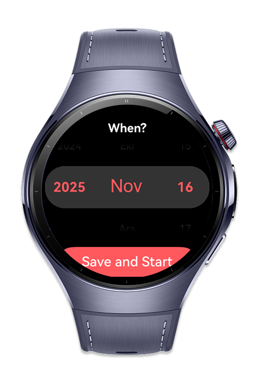
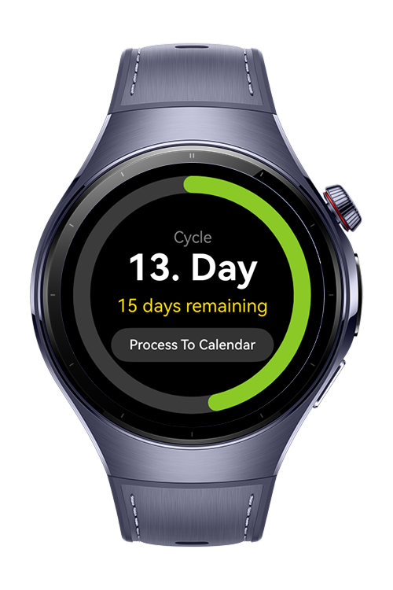
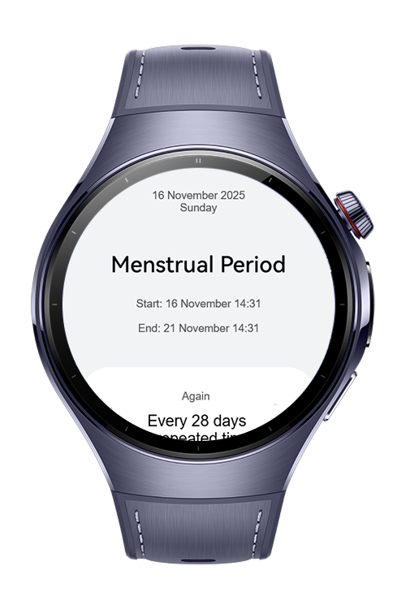
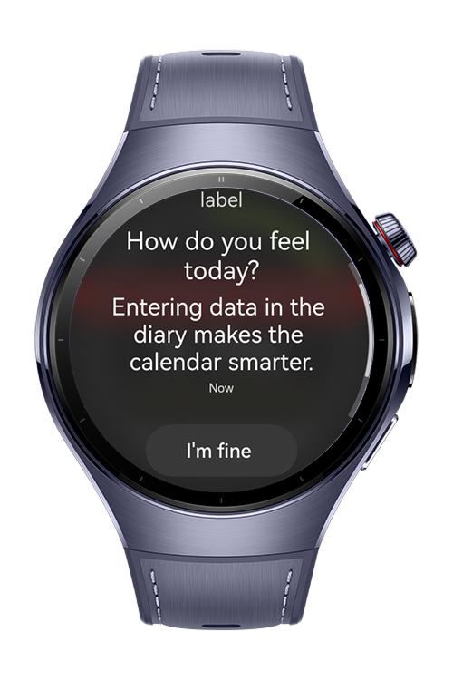

> **Note:** To access all shared projects, get information about environment setup, and view other guides, please visit [Explore-In-HMOS-Wearable Index](https://github.com/Explore-In-HMOS-Wearable/hmos-index).

# Women's Health

**Women's Health** is a personal health assistant for HarmonyOS Next wearable devices that features cycle tracking,
intelligent calendar synchronization, and proactive background reminders using ArkTS.

# Preview

<p align="left">
    
    
    
    
</p>

# Use Cases

* Cycle Dashboard:** Visualizes the current cycle day and days remaining using a dynamic circular gauge UI optimized for wearables.
* Smart Calendar Sync (Calendar Kit):** Automatically calculates and populates the device's native calendar with estimated period dates for the next 12 months.
* Proactive Reminders (Reminder Agent):** Background alarm system that triggers a "1 Day Left" alert even when the app is closed/killed.
* Interactive Symptom Logging:** Actionable notifications ("How do you feel?") allowing users to log symptoms directly from the notification shade.
* Data Persistence: Securely stores user cycle history locally using `PersistentStorage`.

# Technology

## Stack

**Languages**: ArkTS, ArkUI  
**Frameworks**: HarmonyOS SDK 6.0.0  
**Tools**: DevEco Studio 6.0.0  
**Libraries/Kits**:

- @kit.BasicServicesKit
- @kit.AbilityKit
- @kit.CalendarKit
- @kit.BackgroundTasksKit
- @kit.NotificationKit

## Required Permissions
- ohos.permission.READ_CALENDAR
- ohos.permission.WRITE_CALENDAR
- ohos.permission.PUBLISH_AGENT_REMINDER

# Directory Structure

```
│   module.json5
│
├───ets
│   ├───entryability
│   │       EntryAbility.ets
│   │
│   ├───entrybackupability
│   │       EntryBackupAbility.ets
│   │
│   ├───pages
│   │       DashboardPage.ets
│   │       Index.ets
│   │       SetupPage.ets
│   │
│   └───services
│           CalendarService.ets
│           NotificationService.ets
│
└───resources
    ├───base
    │   ├───element
    │   │       color.json
    │   │       float.json
    │   │       string.json
    │   │
    │   ├───media
    │   │       background.png
    │   │       foreground.png
    │   │       layered_image.json
    │   │       startIcon.png
    │   │
    │   └───profile
    │           backup_config.json
    │           main_pages.json
    │
    ├───dark
    │   └───element
    │           color.json
    │
    └───rawfile
```

# Constraints and Restrictions

## Supported Device

- Huawei Watch 5

# License

**Women's Health** is distributed under the terms of the **MIT License**
See the [LICENSE](LICENSE) for more information.


